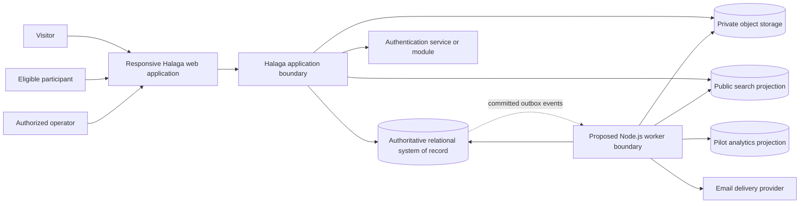
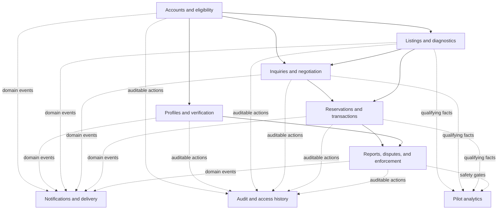

# Halaga MVP Logical Domain Model and System Boundaries

- Status: Initial architecture model
- Last updated: 2026-10-12
- Product authority: `PROJECT.md`
- Architecture overview: `architecture.md`
- Decision record: ADR-069

## 1. Modeling position

Halaga uses PostgreSQL as its authoritative relational system of record for transactional and policy state. The model is logically modular but initially shares one transaction boundary. Search, analytics, email delivery, and other read models consume committed domain events and may be rebuilt. Private object storage contains file bytes only; relational records own identity, authorization, lifecycle, integrity metadata, and retention state.

This model remains vendor-neutral for hosting. ADR-083 selects Prisma ORM 7 and migrations; ADR-084 settles the first physical schema choices. The first account/listing migration aligns Better Auth core models and installs the foundation SQL checks, revision FKs, history-update triggers, and publication-availability exclusion constraint. See `PHYSICAL_SCHEMA_REVIEW.md` for verified enforcement and remaining command gates. ADR-074 selects Better Auth, ADR-073 selects PostgreSQL-backed durable jobs, and ADR-076 selects PostgreSQL for MVP search; these do not select hosting vendors.

The initial transactional-email provider is Brevo Free under ADR-075. Other managed-service and hosting vendors remain undecided.

## 2. Logical system context

Trust-boundary rules:

- The application boundary authorizes every command and private query; the web client is never trusted to enforce role or field privacy.
- Search receives only approved public listing projections and opaque public identifiers.
- Analytics receives purpose-defined event facts with sensitive values excluded or irreversibly transformed where required.
- Email receives only privacy-reviewed template data.
- Object access uses short-lived authorized retrieval or an equivalent mediated path; permanent public object URLs are not used for private originals.
- Background workers request the same guarded transitions as interactive commands rather than directly forcing terminal state.

## 3. Logical modules

Modules are code and ownership boundaries, not independently deployed microservices. Cross-module writes that must be atomic use the shared PostgreSQL transaction. The accepted web runtime and proposed Node.js worker use the same repository and domain code; neither becomes a separate domain owner.

### 3.1 Runtime responsibilities

| Runtime | Responsibilities | Must not do |
| --- | --- | --- |
| Next.js web | Render responsive pages; authenticate requests; serve authorized queries; validate and execute interactive commands; create upload intents; expose operator tools | Run long media jobs inline; trust client projections; bypass module services |
| Node.js worker (proposed) | Evaluate durable deadlines; deliver notifications; process media/evidence; update derived search and analytics projections; execute retention work | Own interactive truth; force stale transitions; directly mutate another module's tables outside guarded commands |

If accepted, both runtime roles use the same versioned TypeScript domain and application modules. A deployment must not run incompatible web and worker schema/event versions simultaneously beyond a migration's documented compatibility window.

## 4. Core relationship model

```mermaid
erDiagram
    USER_ACCOUNT ||--o| PROFESSIONAL_PROFILE : has
    USER_ACCOUNT ||--o{ USER_BLOCK : initiates
    USER_ACCOUNT ||--o{ ACCOUNT_RESTRICTION : receives
    PROFESSIONAL_PROFILE ||--o{ VERIFICATION_APPLICATION : submits
    VERIFICATION_APPLICATION ||--o{ VERIFICATION_REVIEW : receives

    USER_ACCOUNT ||--o{ LISTING : owns
    LISTING ||--o{ LISTING_REVISION : records
    LISTING_REVISION ||--|{ LISTED_ITEM_GROUP : describes
    LISTED_ITEM_GROUP ||--o{ DIAGNOSTIC_ANSWER : answers
    LISTING_REVISION ||--o{ MEDIA_ASSET : uses
    LISTING ||--o{ PUBLICATION_CYCLE : publishes

    LISTING ||--o{ NEGOTIATION : receives
    USER_ACCOUNT ||--o{ NEGOTIATION : buys_through
    NEGOTIATION ||--o{ MESSAGE : contains
    NEGOTIATION ||--o{ PROPOSAL : contains
    NEGOTIATION ||--o{ REVISION_ACKNOWLEDGEMENT : acknowledges

    LISTING ||--o{ RESERVATION : reservation_history
    PROPOSAL ||--o| RESERVATION : accepted_as
    RESERVATION ||--o{ BACKUP_RELATION : pauses
    NEGOTIATION ||--o{ BACKUP_RELATION : classified_by
    RESERVATION ||--o{ APPOINTMENT_VERSION : schedules
    RESERVATION ||--o{ COMPLETION_CONFIRMATION : receives
    RESERVATION ||--o| TRANSACTION_OUTCOME : closes_as

    USER_ACCOUNT ||--o{ CASE : reports
    CASE ||--o{ CASE_PARTY : involves
    CASE ||--o{ CASE_STATEMENT : receives
    CASE ||--o{ CASE_EVIDENCE : contains
    CASE ||--o{ CASE_PLATFORM_RECORD : attaches
    CASE ||--o{ INTERIM_RESTRICTION : may_apply
    CASE ||--o| PLATFORM_FINDING : concludes
    PLATFORM_FINDING ||--o{ ENFORCEMENT_ACTION : supports
    CASE ||--o{ CASE_APPEAL : may_receive

    USER_ACCOUNT ||--o{ NOTIFICATION : receives
    NOTIFICATION ||--o{ DELIVERY_ATTEMPT : delivers
    USER_ACCOUNT ||--o{ AUDIT_EVENT : acts_in
    USER_ACCOUNT ||--o{ SENSITIVE_ACCESS_EVENT : accesses
    OUTBOX_EVENT ||--o{ DELIVERY_ATTEMPT : causes
```

The diagram is intentionally logical: several records may share supporting tables such as timestamps, actor references, or retention metadata in implementation, but the named concepts must not collapse semantically.

## 5. Aggregate ownership and invariants

### 5.1 Account aggregate

Owns:

- User account, private eligibility attributes, email-verification state, deletion lifecycle
- Blocks and account restrictions
- Public display-name projection

Invariants:

- A person cannot perform gated marketplace actions until adult attestation, eligibility, and email verification pass.
- Blocking prevents new ordinary interactions but cannot erase or strand active workflows.
- Full account deletion is rejected while any unresolved-workflow guard exists.
- Retained transaction identity becomes `Deleted user` after eligible deletion.

Better Auth owns email/password credentials, sessions, verification tokens, and authentication identity tables in the shared PostgreSQL database. The domain account has a unique stable mapping to the Better Auth user identity. The domain still owns marketplace eligibility, adult attestation, email-verification action gates, staff roles, restrictions, blocks, deletion lifecycle, and all marketplace authorization.

An authenticated but unverified user may sign in and browse. The server denies publishing, pre-offer inquiries, and proposals until the domain's verified-email gate passes. A session or Better Auth role alone never authorizes a marketplace or staff action.

### 5.2 Professional profile and verification aggregate

Owns:

- Claimed public business or professional fields
- Application type and status
- Private evidence references
- Review history and current badge state
- Re-review triggers and evidence-retention deadline

Invariants:

- Badge state changes only through an authorized review command.
- Public profile projection never contains private identity evidence.
- Badge revocation or withdrawal starts its six-month evidence-retention period unless a documented case exception applies.

### 5.3 Listing aggregate

Owns:

- Listing identity, owner, type, category/family, lifecycle, current revision
- Publication cycles and public-availability intervals
- Private price expectation
- Immutable or auditable revisions
- Listed item groups, versioned diagnostic answers, derived condition, battery/lock facts
- Media references and their publication eligibility

Invariants:

- A bundle stays within one allowed family and every proposal covers the entire bundle.
- Publication references one validated revision.
- Public projections contain no private expectation, IMEI, exact location, or non-public media metadata.
- A material edit creates a new auditable revision and pauses or suspends affected buyer intent.
- A held revision is not public or searchable.
- One listing has at most one active reservation, enforced at the authoritative store as well as in command logic.

### 5.4 Negotiation aggregate

Owns:

- Exactly one listing, one buyer, and the listing seller
- Private message sequence
- Immutable proposal and counterproposal history
- Current actionable proposal reference
- Listing-revision acknowledgement
- Active, paused-backup, closed, or other negotiation state

Invariants:

- Seller and buyer are different accounts.
- A buyer never reads another negotiation.
- A proposal has a positive PHP amount and fixed 72-hour expiry.
- Only the current eligible proposal can be accepted, withdrawn, rejected, or countered.
- A material listing revision prevents silent carry-forward of the buyer's intent.

### 5.5 Reservation and transaction aggregate

Owns:

- Accepted proposal reference and immutable reserved price
- Buyer, seller, listing, reservation state, and reconfirmation state
- Backup-negotiation relationships
- Appointment versions, acceptances, reschedule count, private location, and expiry threshold
- Completion-confirmation history and per-party supersession
- Original response deadline, first-mismatch timestamp, and fixed correction deadline
- Terminal transaction outcome

Invariants:

- Reservation creation atomically claims the listing's single active-reservation slot.
- Appointment acceptance enforces the seven-day initial horizon, two-reschedule limit, and 14-day absolute horizon.
- Cancellation is allowed only before the first completion confirmation.
- Automatic appointment expiry never creates a no-show finding.
- Reserved price is never overwritten by final-price confirmation.
- Completion requires current matching buyer and seller confirmations.
- Total non-response and unresolved mismatch follow different closure/escalation paths.
- A scheduler retry cannot override a completion, cancellation, accepted reschedule, or support-controlled state.

### 5.6 Case aggregate

Owns:

- Case type, reporter, subject, related listing/reservation/transaction where applicable
- Notice, response deadline, one permitted extension, and participant statements
- Evidence metadata, platform-record attachments, and evidence-access history
- Interim restrictions
- Finding, enforcement actions, decision notice, and appeals

Invariants:

- Material-misrepresentation eligibility is buyer-only within 48 hours after mutual completion.
- No-show allegation, automatic expiry, and no-show finding remain distinct.
- Non-response is not automatic substantiation.
- Evidence limits are enforced per participant and case.
- Findings use `Substantiated`, `Unsubstantiated`, or `Inconclusive`.
- Each affected participant has at most one eligible appeal per case.
- Findings, restrictions, and enforcement actions are separate auditable records.

### 5.7 Notification aggregate

Owns:

- Recipient, originating domain event, notification type, privacy-safe rendering data
- In-app read/unread state
- Per-channel delivery state and attempts

Invariants:

- A domain transition and its notification intent commit atomically through the outbox.
- Delivery failure never reverses the domain transition.
- A logical event creates at most one logical notification of a given type for a recipient.
- Email rendering cannot receive private offer amounts, full IMEI, exact location, original evidence, or unnecessary message content.

### 5.8 Durable-work aggregate

Owns:

- Transactional outbox events created with domain state changes
- Durable jobs for scheduled deadlines, notifications, media processing, projection updates, and retention actions
- Job payload version, due instant, attempt/retry state, lease, outcome, and failure record
- Idempotency/processed-work records for consumers and guarded commands

Invariants:

- A domain transition and its required outbox/job records commit atomically.
- A worker must hold an unexpired claim lease before processing a job.
- Job execution is idempotent; a reclaimed or retried job cannot create duplicate domain effects.
- A retry never changes the original business deadline or invents a new domain event.
- Permanent, invalid, or exhausted work is visible as failed work and is not silently discarded.
- Manual retry creates an auditable new attempt and cannot bypass authorization or current-state guards.

### 5.9 Audit and sensitive-access records

Audit events record business actions and state changes. Sensitive-access events record purposeful access to restricted data such as IMEI, verification evidence, exact appointment location, messages accessed for support, and case evidence.

These histories are append-only from ordinary application paths. Corrections use new linked records rather than in-place removal of prior history.

## 6. Key logical records

| Record | Key fields or responsibilities | Privacy class |
| --- | --- | --- |
| `user_account` | eligibility, verification, display identity, deletion state | mixed; explicit projection required |
| Better Auth identity/session tables | credentials, session lifecycle, verification/reset tokens, account identity | restricted authentication data |
| `listing` | owner, lifecycle, category, type, current revision, active reservation guard | mixed |
| `listing_revision` | version, author, materiality, immutable facts, derived summary | mixed |
| `listed_item_group` | identity, quantity, applicability, condition, battery and lock facts | public candidate plus restricted fields |
| `diagnostic_answer` | schema version, question key, structured answer, detail | public candidate where approved |
| `media_asset` | object key, kind, hash, scan/process state, derivatives, retention | private metadata; selected derivatives public |
| `negotiation` | listing, buyer, seller, acknowledged revision, state | participant-private |
| `message` | author, body, moderation state, timestamp | participant-private |
| `proposal` | amount, proposer, expiry, status, supersession | participant-private |
| `reservation` | accepted proposal, reserved price, state, deadlines | reserved-transaction-private |
| `appointment_version` | method, PHT presentation data, exact instant, private location, acceptance | reserved-transaction-private |
| `completion_confirmation` | party, final price assertion, completion assertion, superseded record | reserved-transaction-private |
| `transaction_outcome` | terminal kind, final price only when matched, closure timestamp | private; aggregated facts restricted |
| `case` | type, timing, state, related subjects, SLA | restricted |
| `case_evidence` | owner, object reference, hash, scan/quarantine, retention | restricted evidence |
| `platform_finding` | outcome, reasons, relied-upon evidence | restricted |
| `enforcement_action` | type, scope, effective period, reason, actor | restricted |
| `notification` | event, recipient, safe template data, read state | account-private |
| `outbox_event` | event type/version, aggregate, payload, publication state | internal; payload minimized |
| `durable_job` | work type/version, due instant, payload, lease, retry/outcome state | internal; payload minimized |
| `job_attempt` | job, worker claim, start/end, result, error classification | internal/audit |
| `failed_job` | terminal failure, diagnostic summary, retry authority/state | restricted operations |
| `audit_event` | actor, command, target, prior/new state, reason, correlation | staff/audit |
| `sensitive_access_event` | staff actor, purpose, restricted target, timestamp | staff/audit |

## 7. Transaction boundaries and concurrency

The following operations commit as single relational transactions:

1. Publish revision + listing state + public-projection outbox event.
2. Accept proposal + create reservation + claim active-reservation slot + pause competing negotiations + notification intents.
3. Material edit + new listing revision + affected negotiation/reservation state + notification intents.
4. Accept appointment version + increment accepted-reschedule count where applicable + compute expiry + notification intents.
5. First completion confirmation + disable cancellation + create original response deadline + notification intent.
6. Later confirmation/correction + compute match or first fixed mismatch deadline + notification intents.
7. Scheduler timeout + compare current version/state + terminal transition or support-case creation.
8. Case finding + permitted actions + decision notice and audit records.

Concurrency mechanisms may use version checks, row locking, constrained writes, or equivalent database features. Regardless of implementation, stale commands return a conflict and the current authoritative state; they do not silently overwrite it.

Idempotency keys are scoped to actor and command intent. Repeating an accepted request returns the original result. Reusing a key for different input is rejected.

The initial worker persistence design uses PostgreSQL tables and transactions, not an external broker. A worker claims eligible work using an expiring lease and a concurrency-safe query. If a worker crashes or loses its lease, another worker may reclaim the job after the lease expires. Handler design must tolerate this overlap through idempotency and current-state checks.

## 8. Relational constraints that must exist

The eventual physical design must enforce equivalents of:

- One active reservation per listing.
- One negotiation per listing/buyer pair unless a later ADR explicitly permits multiple threads.
- Positive proposal and final-price values.
- One current listing revision and one current actionable proposal reference.
- One active accepted appointment version per reservation.
- At most one non-superseded completion confirmation per reservation/party.
- At most one appeal per case/affected participant.
- Unique logical notification per originating event/type/recipient.
- Unique processed-consumer marker for idempotent outbox consumers where needed.
- At most one current non-terminal durable-job record for a deduplicated work key where duplicate scheduling would be harmful.
- At most one active lease per durable job.

Application validation supplements these constraints but does not replace them.

## 9. Derived projections

### 9.1 Public listing projection

Contains only published, approved fields required for browse, filters, cards, and listing detail. It excludes price expectation, offer activity, buyer identities, IMEI, exact location, private messages, appointment data, and moderation/evidence facts.

### 9.2 Search projection

Contains approved public title, brand, model, description, keywords, category, condition, barangay, listing type, public publication timestamp, and public media references. Removal, hold, reservation pause, expiry, and republication emit explicit projection events.

### 9.3 Seller offer-comparison projection

A server-authorized private read model combining each negotiation's current proposal, buyer-visible trust signals, intended use, fulfillment context, expiry, and the seller's private expectation. It is never indexed or cached as public content.

### 9.4 Operator queue projection

Contains only the minimum triage data required to prioritize held listings, urgent reports, routine cases, verification, and appeals. Opening restricted detail performs a new authorization check and records sensitive access where required.

### 9.5 Pilot analytics projection

Consumes event-time facts for public exposure intervals, valid offers by distinct eligible buyers, reservation/completion outcomes, pilot start, and safety gates. Metrics are reproducible from versioned rules and do not read mutable current status as a substitute for event history.

## 10. File and evidence boundary

The relational store owns:

- logical asset identity and owner;
- object key, content type, byte length, and integrity hash;
- upload, malware-scan, metadata-strip, derivative, quarantine, and publication states;
- authorization and retention classification;
- links to listing revisions, verification applications, or cases.

Object storage owns only original and derived bytes. An uploaded object is not usable evidence or public media until its relational processing state permits that use.

Deletion and retention workers select eligible relational asset records first, then delete objects idempotently and record completion. Orphan detection compares object inventory with authoritative relational references without treating object presence as business state.

## 11. Deadline model

Every durable deadline record includes:

- deadline type and owning aggregate;
- exact due instant;
- originating policy/rule version;
- current state/version expected by the transition;
- processed timestamp and outcome;
- retry metadata without changing the business due instant.

Workers may run late. They evaluate the authoritative current state at execution time and apply the transition as of the recorded deadline rules. User-facing dates display in PHT. Business-day deadlines use the Monday-through-Saturday PHT calendar and a versioned calculator.

For ordinary asynchronous work, a retry policy records its error class, next eligible attempt, and attempt count. Transient failures use bounded exponential backoff. Permanent validation/authorization failures and failures that exhaust the versioned job-class retry allowance become failed jobs. Failed jobs require operator review or an authorized controlled retry; they are not silently deleted. The retry allowance, lease duration, heartbeat policy, and alert thresholds remain operational parameters to set before deployment, not hidden code defaults.

## 12. Retention and deletion hooks

Records carry retention classification and, where known, a calculated eligibility timestamp. Terminal transaction closure starts the 24-month standard transaction retention clock. Verification evidence uses the badge lifecycle rule. Case evidence follows the applicable case/transaction retention rule.

Uncompleted negotiations follow ADR-077: private message and proposal content is eligible for deletion/anonymization six months after final closure, with a later closure starting a fresh period if reopened first. Exceptions follow ADR-079. Provider-specific backup purge timing and deletion propagation remain deferred. Physical schemas must therefore avoid assuming one universal deletion timestamp.

## 13. Open physical-design decisions

- PostgreSQL 18 is selected by ADR-083; managed hosting and connection model remain open. Hosting must support the foundation's native `btree_gist` extension.
- Better Auth 1.x and the Prisma migration path are selected; the installed core schema is aligned. Session lifetime, cookie settings, and durable multi-instance rate-limiting configuration remain open.
- Domain identifiers use Prisma-generated UUIDs under ADR-084; Better Auth identifiers remain provider-shaped and separately mapped under ADR-074
- Timestamp and PHT business-calendar implementation
- Row-level security use versus application-only authorization with database roles
- Encryption and key-management responsibilities
- Outbox polling versus change-data-capture mechanism
- PostgreSQL search text configuration, ranking, and query/index tuning
- Analytics store or relational projection strategy
- Object storage and malware-processing pipeline
- PostgreSQL and private-object backup/restore implementation, recovery test, and deletion propagation; the accepted pilot targets are RPO ≤24 hours/RTO ≤24 hours (ADR-082)

All product/vendor evaluations must apply ADR-071's free-first constraint. A nominally free service is unsuitable when meeting Halaga's required privacy, audit, backup, or retention controls would require an unapproved paid feature. Public-pilot readiness must be rechecked against the providers' current free-tier limits before registration opens.
